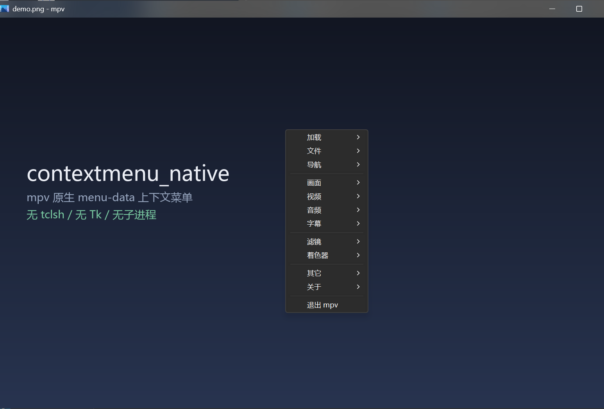

# mpv-contextmenu-native



基于 **mpv 原生菜单 API**（`menu-data` 属性 + `context-menu` 命令）的上下文菜单，
不启动任何子进程，**不需要 tclsh / Tk**。

是 [`contextmenu_gui`](https://github.com/Carmanaught/mpv-contextmenu_gui) 的替代实现。

菜单条目与本项目的配置字段对照 MPV_lazy 上游：
<https://github.com/A-Archives-and-Forks/MPV_lazy/tree/main/portable_config/scripts/contextmenu_gui>

## 原理

```
Lua 构建菜单树
    → mp.set_property_native("menu-data", ...)
    → mp.command("context-menu")
    → mpv 核心 cmd_context_menu()
    → vo_control(VOCTRL_SHOW_MENU)
    → Windows: CreatePopupMenu + TrackPopupMenuEx（系统原生菜单）
```

选中菜单项后由 mpv 自己执行该条的 `cmd`，没有 stdout/JSON 回传，也没有子进程。

## 要求

- mpv **>= 0.42**（`menu-data` / `context-menu` 从该版本开始提供）
- Windows 上走 Win32 原生菜单；其他平台见 `context_menu.lua`

## 安装

把两个目录复制到 mpv 配置目录：

```
mpv/
├── scripts/
│   └── contextmenu_native/
│       ├── main.lua
│       └── contextmenu_native_menu.lua
└── script-opts/
    └── contextmenu_native.conf
```

或者用命令行加载本仓库而不复制：

```
mpv --script="E:/MyCode/Scripts/mpv-contextmenu-native/scripts/contextmenu_native"
```

**按键在 `input.conf` 中配置**，脚本自身不绑定任何键：

```
MBTN_RIGHT	script-message-to contextmenu_native show
```

如果同时装着 `contextmenu_gui`，请只保留其中一条绑定。

注意：**鼠标必须停在视频窗口内**，否则 mpv 不会弹出菜单（见「已知限制」）。

## 配置

`script-opts/contextmenu_native.conf`：

| 键 | 默认 | 说明 |
|---|---|---|
| `show_shortcut` | `no` | 是否在菜单项右侧显示快捷键文本；`yes` 时使用菜单定义里的快捷键 |
| `filter01..10B/D/G` | 空 | 滤镜条目，字段与 `contextmenu_gui.conf` 一致 |
| `shader01..10B/D/G` | 空 | 着色器条目，同上 |

`filterNNB` 文本、`filterNND` 命令、`filterNNG=yes` 表示执行后重新弹菜单。
可以直接把 `contextmenu_gui.conf` 里的滤镜/着色器段落复制过来。

也可以用脚本消息手动触发：

```
script-message-to contextmenu_native show
```

## 与 contextmenu_gui 的差异

| | contextmenu_gui | 本项目 |
|---|---|---|
| 外部进程 | tclsh / wish | 无 |
| 字体、字号 | `fontFace` / `fontSize` 可配 | 系统菜单，不可配 |
| 菜单位置 | 可传 x/y | 跟随鼠标 |
| 菜单可越出窗口 | 可以 | 可以（系统菜单） |
| 点完菜单重弹到子菜单 | 支持（postcascade） | 不支持，只能回到顶层 |
| DPI 缩放 | Tk 处理 | 系统处理 |
| 动态状态（勾选/禁用） | 每次弹出求值 | 每次弹出重建 `menu-data`，等效 |
| 命令为 Lua 函数 | 直接调用 | 转成 `script-message` 回调 |
| 按键绑定 | 脚本内 `add_key_binding` | 只在 `input.conf` 配置 |

## 已知限制

1. **鼠标必须在 mpv 窗口内**。`mp_win32_menu_show` 会检查
   `PtInRect(客户端区域)`，鼠标在窗口外时直接返回，不弹菜单。
   这是 mpv 的实现行为，不是本脚本的缺陷。
2. 菜单没有字体、颜色、圆角等外观选项，完全跟随系统主题。
3. 原生菜单没有 `postcascade`，`G=yes` 的条目执行后重新弹出会回到顶层菜单。
4. 没有项目符号/图标的自定义能力。
5. `cmd` 必须是字符串，函数型命令通过 `script-message-to contextmenu_native invoke <id>` 间接执行。
6. 菜单项右侧默认不显示快捷键文本，由 `show_shortcut` 控制；子菜单条目不会有快捷键文本。

## 验证

```
python tests/verify.py
```

环境变量 `MPV_EXE` 可指定 mpv 路径。脚本会启动一个最小 mpv 会话，检查：

- 脚本加载无 Lua 错误
- `menu-data` 结构（子菜单、分隔线、动态播放列表、勾选状态）
- 原生菜单窗口（类名 `#32768`）确实弹出并能关闭
- 脚本不注册按键绑定（按键由 `input.conf` 提供）
